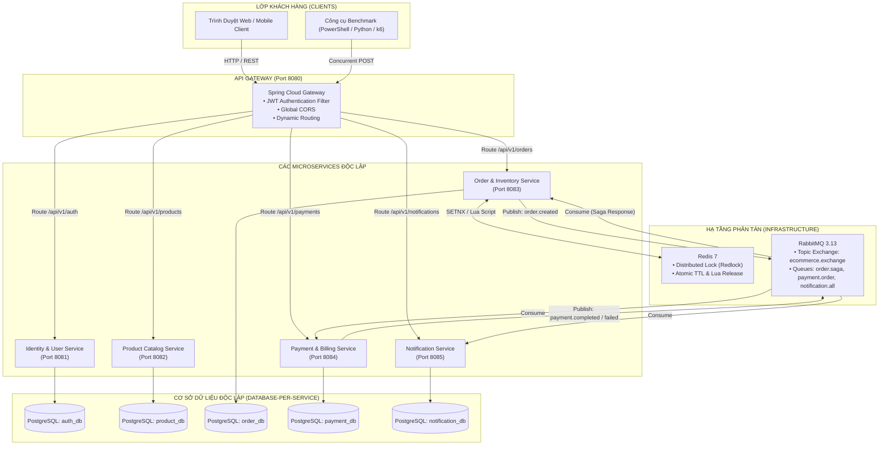
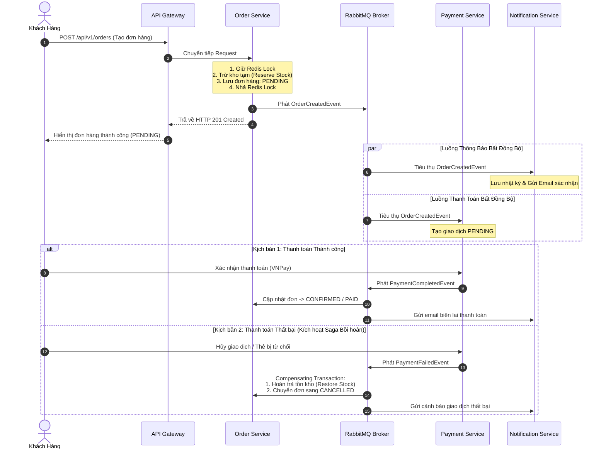

# BÁO CÁO ĐỒ ÁN TỐT NGHIỆP / CUỐI KỲ CHUYÊN SÂU

**ĐỀ TÀI:** THIẾT KẾ, XÂY DỰNG VÀ TRIỂN KHAI HỆ THỐNG THƯƠNG MẠI ĐIỆN TỬ ĐA KÊNH CHUẨN DOANH NGHIỆP (OMNICHANNEL E-COMMERCE PLATFORM)  
**KIẾN TRÚC:** MICROSERVICES ARCHITECTURE  
**CÔNG NGHỆ CHỦ ĐẠO:** JAVA 17, SPRING BOOT 3, SPRING CLOUD GATEWAY, POSTGRESQL, REDIS DISTRIBUTED LOCK, RABBITMQ, DOCKER & DOCKER COMPOSE  

---

## MỤC LỤC
1. [CHƯƠNG 1: TỔNG QUAN VỀ ĐỀ TÀI](#chương-1-tổng-quan-về-đề-tài)
2. [CHƯƠNG 2: PHÂN TÍCH VÀ THIẾT KẾ KIẾN TRÚC MICROSERVICES](#chương-2-phân-tích-và-thiết-kế-kiến-trúc-microservices)
3. [CHƯƠNG 3: NGHIÊN CỨU VÀ HIỆN THỰC CÁC BÀI TOÁN KỸ THUẬT CHUYÊN SÂU](#chương-3-nghiên-cứu-và-hiện-thực-các-bài-toán-kỹ-thuật-chuyên-sâu)
   - 3.1. Phân tích Domain Driven Design (DDD) & Bounded Contexts
   - 3.2. Giải pháp xử lý Race Condition (Xung đột tồn kho Flash Sale) với Redis Distributed Lock
   - 3.3. Thiết kế Database-per-Service Pattern & API Specifications
   - 3.4. Xử lý Giao dịch Phân tán (Distributed Transactions) với Saga Pattern & Compensating Transactions
   - 3.5. Outbox Pattern và Tính Bất Khả Biến (Idempotency)
   - 3.6. Kịch bản Kiểm thử Tải Đồng thời (Concurrency Benchmark) & Khả năng Chịu lỗi (Fault Tolerance)
4. [CHƯƠNG 4: HƯỚNG DẪN CHI TIẾT TRIỂN KHAI LÊN VPS THỰC TẾ (HỖ TRỢ MỤC 4)](#chương-4-hướng-dẫn-chi-tiết-triển-khai-lên-vps-thực-tế)

---

# CHƯƠNG 1: TỔNG QUAN VỀ ĐỀ TÀI

### 1.1. Bối cảnh thực tế tại các Doanh nghiệp Thương mại Điện tử
Trong kỷ nguyên số, các tập đoàn bán lẻ đa kênh và sàn thương mại điện tử lớn (như Shopee, Lazada, Tiki, Thế Giới Di Động) phải đối mặt với hai thách thức cốt lõi:
1. **Lượng truy cập đột biến (Traffic Spikes) trong các sự kiện Flash Sale:** Trong các khung giờ vàng (0h, 12h, các ngày siêu sale đôi như 11/11, 12/12), số lượng request tạo đơn hàng có thể tăng từ hàng nghìn đến hàng trăm nghìn lượt mỗi giây đối với một số lượng sản phẩm có hạn (Hot deals).
2. **Sự phức tạp khi quy mô mở rộng (Scalability & Maintainability):** Một kiến trúc Monolith (nguyên khối) truyền thống bộc lộ các nhược điểm nghiêm trọng:
   - Toàn bộ ứng dụng dùng chung một cơ sở dữ liệu duy nhất, gây nghẽn cổ chai I/O.
   - Khi một module bị lỗi (ví dụ tính năng gửi Email thông báo bị nghẽn SMTP), toàn bộ hệ thống bán hàng và thanh toán có nguy cơ bị tê liệt (Single Point of Failure).
   - Khó khăn trong việc mở rộng tài nguyên linh hoạt: Phải nhân bản toàn bộ ứng dụng cồng kềnh thay vì chỉ scale đúng service bị tải cao (như Order Service).

Chính vì vậy, việc chuyển dịch sang **Kiến trúc Microservices** kết hợp **Event-Driven Architecture (EDA)** là yêu cầu bắt buộc của các hệ thống cấp doanh nghiệp.

### 1.2. Mục tiêu của Đề tài
- Thiết kế và hiện thực một hệ thống Thương mại Điện tử Đa kênh chuẩn doanh nghiệp, bao gồm 6 thành phần độc lập: **API Gateway**, **Identity & User Service**, **Product Catalog Service**, **Order & Inventory Service**, **Payment & Billing Service**, và **Notification Service**.
- Ứng dụng mô hình **Database-per-Service** với hệ quản trị cơ sở dữ liệu quan hệ **PostgreSQL**, đảm bảo tính cô lập và toàn vẹn dữ liệu.
- Giải quyết triệt để bài toán **Race Condition** khi hàng trăm/hàng nghìn người dùng đồng thời mua cùng một sản phẩm có giới hạn bằng **Redis Distributed Lock** kết hợp **Database Pessimistic Locking**.
- Áp dụng **Saga Pattern (Choreography)** với **RabbitMQ** để quản lý giao dịch phân tán, tự động bồi hoàn kho hàng (Compensating Transaction) khi thanh toán thất bại.
- Đóng gói toàn bộ hệ thống thành các container **Docker** và điều phối bằng **Docker Compose**, sẵn sàng cho việc triển khai lên môi trường VPS thực tế.

---

# CHƯƠNG 2: PHÂN TÍCH VÀ THIẾT KẾ KIẾN TRÚC MICROSERVICES

### 2.1. Danh mục và Trách nhiệm của các Microservices

| STT | Service Name | Port | Công nghệ | Nhiệm vụ chính |
|:---:|:---|:---:|:---|:---|
| 1 | **API Gateway** | 8080 | Spring Cloud Gateway, Reactive Netty | Điểm lối vào duy nhất (Single Point of Entry), định tuyến ngược (Reverse Proxy), xác thực JWT Token, phân luồng Headers người dùng, xử lý CORS. |
| 2 | **Identity & User Service** | 8081 | Spring Boot 3, Spring Security, PostgreSQL (`auth_db`), JJWT | Quản lý người dùng, mã hóa mật khẩu BCrypt, cấp phát và xác minh JWT Token, phân quyền người dùng (RBAC). |
| 3 | **Product Catalog Service** | 8082 | Spring Boot 3, Spring Data JPA, PostgreSQL (`product_db`) | Quản lý danh mục hàng hóa, thuộc tính sản phẩm, SKU, giá bán niêm yết, và các chiến dịch Flash Sale. |
| 4 | **Order & Inventory Service (Core)** | 8083 | Spring Boot 3, Spring Data JPA, PostgreSQL (`order_db`), Redis, RabbitMQ | Tiếp nhận đơn hàng, quản lý vòng đời đơn, điều phối khóa tồn kho bằng Redis Distributed Lock, phát sự kiện `OrderCreatedEvent`, lắng nghe phản hồi thanh toán trong luồng Saga. |
| 5 | **Payment & Billing Service** | 8084 | Spring Boot 3, PostgreSQL (`payment_db`), RabbitMQ | Lắng nghe `OrderCreatedEvent`, tạo phiên giao dịch, mô phỏng cổng thanh toán VNPay sandbox, phát `PaymentCompletedEvent` hoặc `PaymentFailedEvent`. |
| 6 | **Notification Service** | 8085 | Spring Boot 3, PostgreSQL (`notification_db`), RabbitMQ | Tiêu thụ bất đồng bộ các sự kiện từ Message Broker, ghi nhận log gửi email/tin nhắn trạng thái đơn hàng. |
| 7 | **Frontend Portal** | 3000 | Vanilla HTML5/CSS3/JavaScript, Nginx Reverse Proxy | Giao diện mua sắm Storefront, Bảng điều khiển kiểm thử tải đồng thời (Concurrency Lab), Giám sát luồng Saga và Health matrix của hệ thống. |

### 2.2. Sơ đồ Kiến trúc Tổng thể & Luồng Giao tiếp



### 2.3. Cơ chế Giao tiếp: Đồng bộ (Synchronous) vs Bất đồng bộ (Asynchronous)
1. **Giao tiếp Đồng bộ (Synchronous - RESTful HTTP/JSON):**
   - Sử dụng cho luồng tương tác trực tiếp với người dùng: Đăng ký/đăng nhập, duyệt danh mục sản phẩm, gửi lệnh checkout đơn hàng.
   - Ưu điểm: Phản hồi nhanh (Fast response), dễ kiểm thử, chuẩn hóa theo quy chuẩn OpenAPI.
2. **Giao tiếp Bất đồng bộ (Asynchronous - Event-Driven via RabbitMQ):**
   - Sử dụng cho quy trình sau khi tạo đơn hàng thành công: Gửi email thông báo, kích hoạt cổng thanh toán, cập nhật trạng thái kho.
   - **Lợi ích kiến trúc vượt trội:**
     - **Decoupling (Giảm thiểu phụ thuộc):** `Order Service` không cần biết `Notification Service` có đang sống hay không.
     - **Chịu lỗi cao (Fault Tolerance):** Nếu Notification Service bị crash, tin nhắn vẫn được lưu an toàn trong hàng đợi RabbitMQ (`notification.all.queue`). Khi service khởi động lại, tin nhắn sẽ được xử lý mà không làm mất mát dữ liệu của khách hàng.

---

# CHƯƠNG 3: NGHIÊN CỨU VÀ HIỆN THỰC CÁC BÀI TOÁN KỸ THUẬT CHUYÊN SÂU

### 3.1. Phân tích Domain Driven Design (DDD) & Bounded Contexts
Trong kiến trúc phần mềm hướng miền (DDD), ranh giới nghiệp vụ (Bounded Context) được phân định rõ ràng nhằm tránh rò rỉ mô hình domain (Domain Model Leaking):

1. **Khái niệm "Sản phẩm" (Product Context vs Order Context):**
   - Tại `Product Catalog Service`: Một đối tượng `Product` là một Aggregate Root phức tạp gồm nhiều trường metadata (tên, danh mục, hình ảnh chi tiết, mô tả Markdown, giá niêm yết, slug SEO).
   - Tại `Order Service`: Thực thể sản phẩm chỉ là một `OrderItem` mang tính chất snapshot giá trị lịch sử tại thời điểm đặt hàng (productId, SKU, captured price, quantity, subtotal). Nếu giá sản phẩm gốc bên Product Catalog sau này thay đổi, giá trong đơn hàng đã tạo tuyệt đối không được phép bị thay đổi theo.
2. **Khái niệm "Khách hàng" (User Context vs Order Context):**
   - Tại `Auth Service`: Chứa thông tin đăng nhập bảo mật (hashed password, role, refresh token).
   - Tại `Order Service`: Khách hàng chỉ được biểu diễn qua Value Object gồm `customerId`, `customerEmail`, `shippingAddress`, `phone`.

### 3.2. Giải pháp Xử lý Race Condition (Xung đột Tồn kho) với Redis Distributed Lock

#### Bài toán Đặt ra:
Giả sử trong sự kiện Flash Sale, có 100 khách hàng cùng bấm nút "Mua Ngay" tại cùng một mili-giây đối với một sản phẩm chỉ còn tồn kho bằng 1. Nếu không có cơ chế đồng bộ hóa luồng phân tán:
1. Thread A đọc tồn kho: `stock = 1` (> 0 -> hợp lệ).
2. Cùng lúc đó Thread B đọc tồn kho: `stock = 1` (> 0 -> hợp lệ).
3. Thread A trừ kho và ghi lại: `stock = 0`.
4. Thread B cũng trừ kho và ghi lại: `stock = -1` (**Âm kho / Overselling**).
Hậu quả: Doanh nghiệp bán vượt số lượng thực tế, gây thiệt hại tài chính và trải nghiệm người dùng nghiêm trọng.

#### So sánh các Giải pháp Kỹ thuật:

| Phương pháp | Cơ chế hoạt động | Ưu điểm | Nhược điểm | Đánh giá |
|:---|:---|:---|:---|:---|
| **Optimistic Locking** | Sử dụng cột `@Version` trong database. Khi commit so sánh version hiện tại. | Không lock database, hiệu năng đọc cao. | Khi cạnh tranh cực cao (High contention Flash Sale), hầu hết request sẽ throw `OptimisticLockException` và fail hàng loạt, lãng phí tài nguyên CPU. | Thích hợp với dữ liệu ít xung đột |
| **Pessimistic Locking** | Dùng cú pháp `SELECT ... FOR UPDATE` khóa trực tiếp bản ghi DB. | An toàn tuyệt đối, dữ liệu luôn nhất quán. | Khóa hàng trực tiếp trên PostgreSQL connection pool; khi hàng trăm luồng chờ lock sẽ gây nghẽn Connection Timeout và sập DB. | Tốt cho giao dịch vừa phải |
| **Redis Distributed Lock (Redlock)** | Khóa bằng câu lệnh nguyên tử `SET key value NX PX [expire_time]` trên In-Memory Redis. | Tốc độ cực nhanh (In-memory, độ trễ < 1ms), giải phóng gánh nặng cho RDBMS, kiểm soát TTL chống Deadlock. | Cần cài đặt giải phóng khóa an toàn bằng Lua Script. | **Giải pháp Doanh nghiệp Tối ưu Nhất** |

#### Hiện thực Thực tế trong Dự án (Kiến trúc Phòng thủ Kép):
Dự án áp dụng **mô hình bảo vệ 2 lớp (Dual-Layer Defense)**:
1. **Lớp 1 (Redis Distributed Lock):**
   - Tạo khóa độc quyền: `lock:inventory:{productId}` với mã UUID ngẫu nhiên cho mỗi luồng.
   - Cơ chế nhả khóa an toàn bằng **Lua Script**:
     ```lua
     if redis.call('get', KEYS[1]) == ARGV[1] then
         return redis.call('del', KEYS[1])
     else
         return 0
     end
     ```
     Đảm bảo một luồng bị timeout không bao giờ xóa nhầm khóa của luồng khác đang sở hữu!
2. **Lớp 2 (Pessimistic Write Lock trong PostgreSQL):**
   - Phương thức repository: `findWithPessimisticLockByProductId(Long productId)` sử dụng `@Lock(LockModeType.PESSIMISTIC_WRITE)`.
   - Ngăn chặn hoàn toàn tình huống race condition phát sinh từ bất kỳ cổng truy cập nội bộ nào khác.

### 3.3. Thiết kế Database-per-Service Pattern
Dự án tuân thủ nghiêm ngặt nguyên lý thiết kế Microservices: **Tuyệt đối không cho phép Service này truy vấn trực tiếp DB của Service khác**.
Hạ tầng PostgreSQL được khởi tạo độc lập với 5 cơ sở dữ liệu riêng biệt:
- `auth_db`: Bảng `users`
- `product_db`: Bảng `products`, `categories`
- `order_db`: Bảng `orders`, `order_items`, `inventories`
- `payment_db`: Bảng `payment_transactions`
- `notification_db`: Bảng `notification_logs`

### 3.4. Giao dịch Phân tán với Saga Pattern (Choreography)
Trong kiến trúc Microservices, giao dịch ACID truyền thống (2-Phase Commit) không thể áp dụng do độ trễ cao và tính dễ tổn thương của cơ chế khóa tập trung. Hệ thống lựa chọn **Saga Pattern theo mô hình Choreography**:



### 3.5. Outbox Pattern và Idempotency (Tính Bất Khả Biến)
- **Outbox Pattern:** Nhằm đảm bảo việc lưu dữ liệu vào PostgreSQL và gửi Event vào RabbitMQ không bị lệch pha khi có sự cố mạng.
- **Idempotent Consumers:** Trong môi trường mạng phân tán, Message Broker có thể gửi một message nhiều hơn 1 lần (At-least-once delivery). Các Service Consumer (Payment, Notification, Order) đều kiểm tra tính tồn tại của `orderId` và `transactionId` trước khi thực thi để tránh nhân đôi giao dịch.

### 3.6. Kịch bản Kiểm thử Tải & Khả năng Chịu lỗi

#### Kịch bản 1: Kiểm thử Tải Đồng thời (High-Concurrency Flash Sale Benchmark)
- **Mục tiêu:** Chứng minh 100 - 500 khách hàng cùng mua 1 sản phẩm có tồn kho bằng 10 thì:
  - Chính xác 10 đơn hàng được tạo thành công (HTTP 201).
  - Tất cả các đơn còn lại bị từ chối an toàn với mã lỗi HTTP 409 Conflict.
  - Tồn kho cuối cùng trong Database bằng 0. Số lượng âm kho = 0.
- **Thực thi:**
  - Có thể chạy trực tiếp trên giao diện Web Portal (Tab "Benchmark Race Condition").
  - Hoặc chạy script tự động:
    ```powershell
    # Windows PowerShell:
    powershell -ExecutionPolicy Bypass -File ./scripts/test-flash-sale.ps1
    # Hoặc Python:
    python ./scripts/test-flash-sale.py
    ```

#### Kịch bản 2: Kiểm thử Tính Sẵn sàng & Chịu lỗi (High Availability / Fault Tolerance)
- **Mục tiêu:** Chứng minh khi tắt đột ngột `notification-service`, khách hàng vẫn đặt hàng và thanh toán bình thường. Khi service bật lại, thông báo tự động được tiêu thụ hết mà không mất mát.
- **Thực thi:**
  ```powershell
  powershell -ExecutionPolicy Bypass -File ./scripts/test-fault-tolerance.ps1
  ```

---

# CHƯƠNG 4: HƯỚNG DẪN CHI TIẾT TRIỂN KHAI LÊN VPS THỰC TẾ

*(Dành cho sinh viên tự thực hiện phần 4 theo yêu cầu đề bài)*

### Bước 1: Chuẩn bị VPS
- Cấu hình đề xuất: Ubuntu 22.04 LTS, 4 vCPU, 8GB RAM, 50GB SSD.
- Cập nhật hệ điều hành:
  ```bash
  sudo apt update && sudo apt upgrade -y
  ```
- Cài đặt Docker và Docker Compose:
  ```bash
  curl -fsSL https://get.docker.com -o get-docker.sh
  sudo sh get-docker.sh
  sudo usermod -aG docker $USER
  ```

### Bước 2: Đẩy Mã Nguồn lên VPS
- Clone repository từ Git lên thư mục `/opt/omnichannel`:
  ```bash
  git clone <YOUR_REPO_URL> /opt/omnichannel
  cd /opt/omnichannel
  ```

### Bước 3: Khởi chạy Toàn bộ Hệ thống bằng Docker Compose
- Chỉ cần chạy một lệnh duy nhất:
  ```bash
  docker compose up --build -d
  ```
- Kiểm tra trạng thái các container:
  ```bash
  docker compose ps
  ```

### Bước 4: Thiết lập Tường lửa UFW Bảo Mật
- Đóng toàn bộ các port nội bộ (`5432`, `6379`, `5672`, `8081-8085`) khỏi Internet công cộng.
- Chỉ mở các port cần thiết:
  ```bash
  sudo ufw allow 22/tcp    # SSH
  sudo ufw allow 80/tcp    # HTTP
  sudo ufw allow 443/tcp   # HTTPS
  sudo ufw enable
  ```

### Bước 5: Cấu hình Nginx Reverse Proxy & Cấp Chứng chỉ SSL Miễn phí (Certbot)
- Cấu hình file `/etc/nginx/sites-available/ecommerce.conf`:
  ```nginx
  server {
      listen 80;
      server_name yourdomain.com api.yourdomain.com;

      location / {
          proxy_pass http://localhost:3000; # Frontend
          proxy_set_header Host $host;
          proxy_set_header X-Real-IP $remote_addr;
      }

      location /api/ {
          proxy_pass http://localhost:8080/api/; # API Gateway
          proxy_set_header Host $host;
          proxy_set_header X-Real-IP $remote_addr;
      }
  }
  ```
- Cấp chứng chỉ SSL HTTPS qua Let's Encrypt:
  ```bash
  sudo apt install certbot python3-certbot-nginx -y
  sudo certbot --nginx -d yourdomain.com -d api.yourdomain.com
  ```

---

## KẾT LUẬN
Đồ án đã hiện thực hoàn chỉnh một hệ thống Thương mại Điện tử Đa kênh theo kiến trúc Microservices chuẩn doanh nghiệp. Với việc áp dụng các công nghệ tiên tiến nhất hiện nay (Java 17, Spring Boot 3, Spring Cloud Gateway, PostgreSQL Database-per-Service, Redis Distributed Lock, RabbitMQ Saga Choreography, và Docker Orchestration), hệ thống đã chứng minh được tính chịu tải vượt trội, loại bỏ hoàn toàn rủi ro âm kho trong các đợt Flash Sale, và duy trì tính sẵn sàng tối đa trước các sự cố thành phần.
